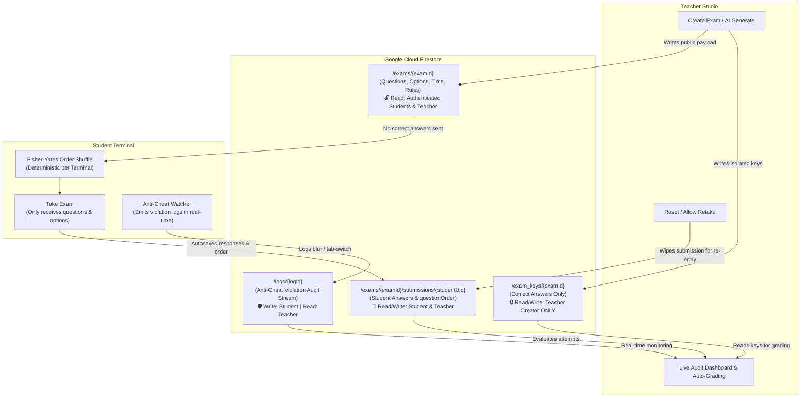

# 🌊 Auros TestQ — Serverless Evaluation Platform with AI Exam Studio & Anti-Cheat

<div align="center">


[](https://react.dev/)
[](https://www.typescriptlang.org/)
[](https://vitejs.dev/)
[](https://tailwindcss.com/)
[](https://groq.com/)
[](https://firebase.google.com/)
[](https://github.com/)
[](LICENSE)

**A high-integrity, serverless evaluation terminal featuring Groq AI exam generation, cryptographic question randomization per terminal, real-time anti-cheat telemetry, and zero-leak answer key isolation.**

[Explore Features](#-key-features) • [Auros Design](#-auros-design-system) • [AI Exam Studio](#-groq-ai-exam-studio) • [Architecture](#-zero-leak-security-architecture) • [Getting Started](#-getting-started) • [Deployment](#-cicd--deployment)

</div>

---

## 🌟 Overview

**Auros TestQ** (Abyssal Evaluation Terminal) is an advanced, high-performance web evaluation platform designed for academic institutions, universities, and certification bodies that demand absolute exam integrity without server maintenance headaches.

Operating on a **100% serverless architecture** powered by **Google Cloud Firestore**, **Firebase Authentication**, and high-speed **Groq LLM acceleration**, Auros TestQ delivers instant question generation, real-time telemetry, terminal-level question randomization, and automated grading with zero-leak answer security.

---

## ✨ Key Features

### 🤖 Groq AI Exam Studio
- **Prompt-to-Exam Generation**: Generate complete, high-quality assessments in seconds simply by writing a topic or domain (e.g. *"Quantum Physics", "TypeScript Advanced Types", "Organic Chemistry"*).
- **Dynamic Model Discovery & Cascade**: Automatically queries available models on your Groq key (`openai/gpt-oss-120b`, `llama-3.3-70b-versatile`, `llama-3.1-8b-instant`, etc.) with intelligent fallback cascades to ensure zero downtime.
- **Granular Customization**: Set question count (1 to 30), question format (multiple choice, true/false, or mixed), difficulty level (*Básico*, *Intermedio*, *Avanzado*, *Experto*), score weighting, and optional custom instructions.
- **Zero-Leak Compatible**: Automatically isolates distractors and answer keys upon generation, preventing correct answers from reaching student devices.

### 🎲 Cryptographic Question Randomization
- **Terminal Anti-Collusion**: Employs a cryptographically secure **Fisher-Yates shuffle** (`crypto.getRandomValues`) to assign a distinct question sequence to every student device. Students sitting side-by-side in computer labs see completely different question orders.
- **Session-Deterministic**: The randomized order is generated upon student join and persisted in the submission record. Accidental page reloads (<kbd>F5</kbd>) or network reconnections maintain the student's assigned order without resetting progress.
- **Decoupled Scoring Engine**: Answers and grading are strictly keyed by unique question IDs (`questionId`), ensuring instant auto-grading regardless of visual display permutation.
- **Teacher Toggle**: Educators can enable or disable randomization per exam with a single switch in the exam editor.

### 👨‍🏫 Teacher Studio & Exam Management
- **Intuitive Exam Builder**: Craft timed evaluations with custom titles, instructions, time limits, and maximum allowed violations.
- **Word Document (.docx) & Text Import**: Ingest dozens of questions in seconds using Testportal-compatible formatting or standard Word uploads.
- **Exam Reset & Retake Capability**: Reset individual student attempts directly from the audit dashboard, allowing students to re-enter and retake evaluations when authorized.
- **Live Submission & Audit Monitor**: Real-time dashboard showing student statuses (`in_progress`, `submitted`, `timed_out`, `disqualified`).
- **Live Anti-Cheat Log Stream**: Timestamped violation events (loss of focus, tab switching, devtools inspection, copy/paste attempts) streamed in real time.
- **Instant Auto-Grading**: Securely evaluates submissions against the protected answer key upon student completion.

### 🧑‍🎓 Student Experience
- **Frictionless Entry**: Join directly with a PIN and student credentials without complex account registration (uses transparent anonymous authentication).
- **Distraction-Free Abyssal UI**: Clean, high-contrast interface designed for maximum readability, concentration, and focus.
- **Auto-Save Resilience**: Every option selected is immediately synchronized to the cloud; power outages or browser closures never lose progress.
- **Synchronized Countdown**: Server-calibrated countdown timer preventing local device clock manipulation.
- **Instant Feedback & Score Breakdown**: Post-submission overview with scores, percentage, and detailed evaluation.

### 🛡️ Anti-Cheat Telemetry Engine
- **Tab & Window Focus Loss**: Detects when students switch browser tabs, open external applications, or move to secondary monitors (`visibilitychange` and `blur` events).
- **Right-Click & Context Menu Interception**: Prevents context menu shortcuts for text searches or external lookups.
- **DevTools & Source Code Blocking**: Intercepts `F12`, `Ctrl+Shift+I`, `Ctrl+Shift+J`, and `Ctrl+U`.
- **Copy / Paste Prevention**: Restricts clipboard shortcuts (`Ctrl+C`, `Ctrl+V`, `Cmd+C`, `Cmd+V`) during active exam sessions.
- **Progressive Warnings & Auto-Disqualification**: Displays non-intrusive alert modals with infraction counts; immediately locks the exam if the threshold is exceeded.

### ⚡ Built-in Mock Fallback Mode
- No Firebase project configured? Auros TestQ automatically detects missing Firebase configuration and activates a full-featured **Local Storage Mock Simulation**, allowing testing, AI generation, grading, and anti-cheat evaluations out of the box.

---

## 🎨 Auros Design System

Auros TestQ is styled according to the strict [Auros Design Specification](DESIGN.md):

* **Abyssal Color Palette**:
  - `Liquid Abyss (#012624)`: Deep primary canvas background.
  - `Liquid Deep (#011d1c)`: Secondary surface for high-contrast inputs and recessed panels.
  - `Liquid Kelp (#003734)`: Elevated surface for cards and interactive containers.
  - `Liquid Mist (#edfffe)` & `Silver Mist (#bbc7c6)`: High-legibility technical text.
  - `Aurora Gradient`: Bioluminescent pill buttons (`.btn-aurora`) with smooth micro-interactions.
* **Surface Stacking over Drop Shadows**: Elevation is achieved purely through water depth luminance shifts (`surface-abyss` → `surface-deep` → `surface-card`), entirely eliminating harsh drop shadows.
* **Border Radii Hierarchy**: Consistent `16px` for cards/panels, `6px` for small controls, pills, and action buttons.
* **Technical Typography**: Medium headings (500 weight) with monospaced metadata labels for real-time instrument precision.

---

## 🔒 Zero-Leak Security Architecture

A primary vulnerability of client-side exam platforms is exposing correct answers in the network payload or client memory. **Auros TestQ eliminates this vulnerability by design**:



### Security Highlights:
1. **Separation of Keys**: Correct answers are stored strictly under `/exam_keys/{examId}`, where Cloud Firestore security rules deny read access to everyone except the authenticated teacher who created the exam.
2. **Immutable Finalization**: Once a submission's status changes from `in_progress` to `submitted`, `timed_out`, or `disqualified`, write rules lock answers from further client modification.
3. **Protected Subcollections**: Student attempts, randomized order maps, and audit logs reside within scoped subcollections protected by granular document-level access rules.

---

## 🛠️ Tech Stack

| Domain | Technology | Description |
|---|---|---|
| **Frontend Framework** | [React 19](https://react.dev/) | Modern component architecture with hooks and concurrent features |
| **Language** | [TypeScript 6](https://www.typescriptlang.org/) | Strict type safety and complete domain contracts |
| **Build & Dev Tool** | [Vite 8](https://vitejs.dev/) | Ultra-fast HMR and optimized production bundle |
| **Styling** | [Tailwind CSS v4](https://tailwindcss.com/) | Modern utility engine with Auros theme specification |
| **AI Engine** | [Groq API](https://groq.com/) | Ultra-fast LLM inference (`gpt-oss-120b`, `llama-3.3-70b`, etc.) |
| **Routing** | [React Router 7](https://reactrouter.com/) | HashRouter for GitHub Pages SPA compatibility |
| **Icons** | [Lucide React](https://lucide.dev/) | Accessible, lightweight iconography |
| **Database & Auth** | [Firebase 12](https://firebase.google.com/) | Cloud Firestore and Firebase Authentication |
| **Randomization** | Web Crypto API | High-entropy Fisher-Yates array shuffling |
| **Linter** | [Oxlint](https://oxc.rs/) | Rust-powered high-speed JavaScript/TypeScript linter |
| **CI/CD** | [GitHub Actions](https://github.com/features/actions) | Automated build and deployment to GitHub Pages |

---

## 📁 Directory Structure

```text
ExamTaker/
├── .github/
│   └── workflows/
│       └── deploy.yml              # GitHub Actions deployment workflow
├── docs/
│   └── MANUAL_DE_CONFIGURACION.md  # Step-by-step setup guide in Spanish
├── public/
│   ├── 404.html                    # SPA fallback for static hosting
│   ├── favicon.svg                 # Application favicon
│   └── icons.svg                   # SVG icons asset
├── src/
│   ├── assets/                     # Brand assets and graphics (hero, logo)
│   ├── components/
│   │   ├── common/
│   │   │   └── Navbar.tsx          # Responsive Auros navigation bar
│   │   └── exam/
│   │       └── AiExamGeneratorModal.tsx # Groq AI assessment generator modal
│   ├── contexts/
│   │   └── AuthContext.tsx         # Teacher authentication & session provider
│   ├── hooks/
│   │   ├── useAntiCheat.ts         # Anti-cheat listeners, throttling & telemetry
│   │   └── useServerTimer.ts       # Server-synchronized countdown hook
│   ├── pages/
│   │   ├── LandingPage.tsx         # Landing page with platform overview & quick access
│   │   ├── TeacherAuth.tsx         # Teacher login / registration form
│   │   ├── TeacherDashboard.tsx    # Teacher exam overview, stats & actions
│   │   ├── ExamEditor.tsx          # Exam creator, Word importer, AI trigger & shuffle toggle
│   │   ├── ExamAudit.tsx           # Live submission monitor, retake resets & violation logs
│   │   ├── StudentEntry.tsx        # PIN validation and student entry gate
│   │   ├── StudentExam.tsx         # Live examination interface with randomized questions
│   │   └── ExamFinished.tsx        # Post-submission feedback and score preview
│   ├── services/
│   │   ├── firebase.ts             # Firebase App, Auth, and Firestore initialization
│   │   ├── firebaseConfig.ts       # Environment-based Firebase configuration
│   │   ├── examService.ts          # Exam CRUD operations with mock fallback
│   │   ├── studentService.ts       # Submissions, answers, shuffle order & violation logging
│   │   ├── aiExamService.ts        # Groq API client, model discovery & question parser
│   │   └── mockStorage.ts          # LocalStorage simulation engine for offline dev
│   ├── types/                      # Domain TypeScript interfaces (exam, auth, log, submission)
│   ├── utils/
│   │   └── shuffle.ts              # Cryptographic Fisher-Yates array shuffle
│   ├── App.tsx                     # Route declarations & role-based guards
│   ├── index.css                   # Global Auros CSS & Tailwind imports
│   └── main.tsx                    # Application bootstrap entrypoint
├── DESIGN.md                       # Auros visual design specification
├── firestore.rules                 # Cloud Firestore security rules
├── database.rules.json             # Firebase Realtime Database rules (legacy)
├── firebase.json                   # Firebase CLI hosting and firestore setup
├── vite.config.ts                  # Vite bundler configuration
└── package.json                    # Project dependencies and npm scripts
```

---

## 🚀 Getting Started

### Prerequisites
- **Node.js**: `v20.x` or `v22.x` (LTS recommended)
- **Package Manager**: `npm` (v10+) or `pnpm` / `yarn`
- **Groq API Key** *(Optional)*: Obtain a free API key from [Groq Console](https://console.groq.com/) for AI exam generation.

### 1. Clone the Repository
```bash
git clone https://github.com/Jlebot7/ExamTaker.git
cd ExamTaker
```

### 2. Install Dependencies
```bash
npm install
```

### 3. Configure Environment Variables
Create a `.env` file in the root directory by copying `.env.example`:

```bash
cp .env.example .env
```

Configure your credentials:

```env
# Firebase Configuration (Cloud Firestore & Authentication)
VITE_FIREBASE_API_KEY=AIzaSyYourApiKeyHere
VITE_FIREBASE_AUTH_DOMAIN=your-project.firebaseapp.com
VITE_FIREBASE_PROJECT_ID=your-project-id
VITE_FIREBASE_STORAGE_BUCKET=your-project.firebasestorage.app
VITE_FIREBASE_MESSAGING_SENDER_ID=123456789012
VITE_FIREBASE_APP_ID=1:123456789012:web:abcdef1234567890

# Optional: Groq AI Key (can also be entered dynamically in the Teacher Studio)
VITE_GROQ_API_KEY=gsk_YourGroqApiKeyHere
```

> **Note**: If Firebase credentials are not provided, Auros TestQ operates smoothly in **Local Mock Fallback** mode using browser storage. If a Groq API Key is not set in `.env`, teachers can paste it directly into the AI modal in the Teacher Studio.

### 4. Run Locally
```bash
npm run dev
```
Open your browser and navigate to `http://localhost:5173`.

---

## 🛡️ Firebase Security Rules Setup

To deploy production security rules to your Cloud Firestore:

1. Install the Firebase CLI:
   ```bash
   npm install -g firebase-tools
   ```
2. Authenticate with your Firebase account:
   ```bash
   firebase login
   ```
3. Deploy Firestore security rules from `firestore.rules`:
   ```bash
   firebase deploy --only firestore:rules
   ```

---

## 📦 Available Scripts

| Script | Command | Description |
|---|---|---|
| **Development** | `npm run dev` | Starts Vite local dev server with Hot Module Replacement (HMR) |
| **Typecheck & Build** | `npm run build` | Compiles TypeScript and builds production distribution in `/dist` |
| **Linting** | `npm run lint` | Runs high-speed Oxlint code analysis |
| **Preview** | `npm run preview` | Locally serves the production build |

---

## 🌐 CI/CD & Deployment

This project includes a production-ready **GitHub Actions Workflow** (`.github/workflows/deploy.yml`) configured to build and deploy the application to **GitHub Pages**.

### Setting up automated GitHub Pages deployment:
1. Go to your repository on GitHub: **Settings > Pages**.
2. Under **Source**, select **GitHub Actions**.
3. Under **Settings > Secrets and variables > Actions**, add the `VITE_FIREBASE_*` and `VITE_GROQ_API_KEY` secrets.
4. Push to `main` or `master` to trigger the automated build and release.

---

## 🤝 Contributing

Contributions are welcome! Please follow these steps:

1. Fork the project.
2. Create a feature branch:
   ```bash
   git checkout -b feat/my-amazing-feature
   ```
3. Commit your changes following [Conventional Commits](https://www.conventionalcommits.org/):
   ```bash
   git commit -m "feat(audit): add CSV export for student exam logs"
   ```
4. Push to the branch:
   ```bash
   git push origin feat/my-amazing-feature
   ```
5. Open a Pull Request.

---

## 📄 License

This project is licensed under the **MIT License**. See the `LICENSE` file for details.
